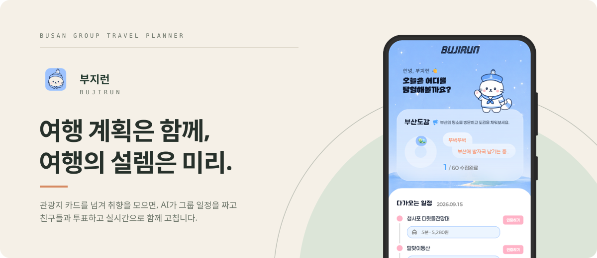
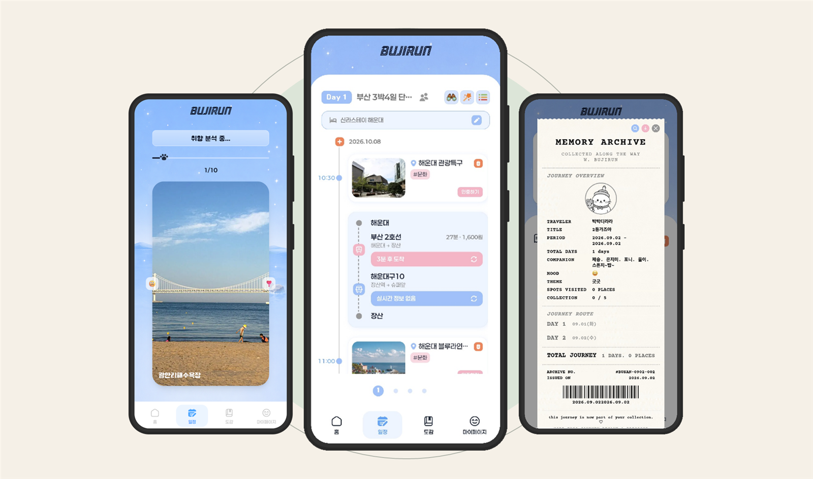
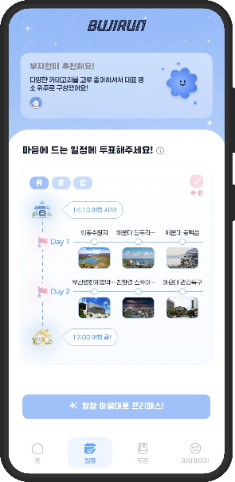
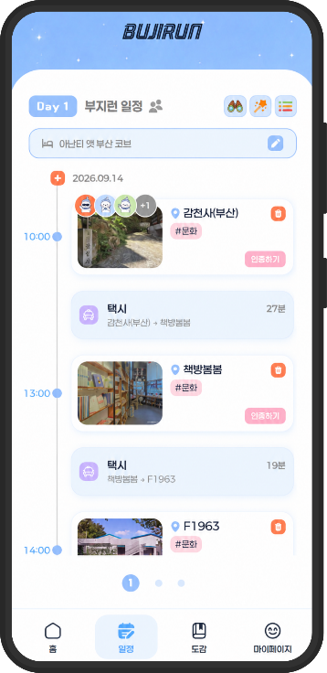
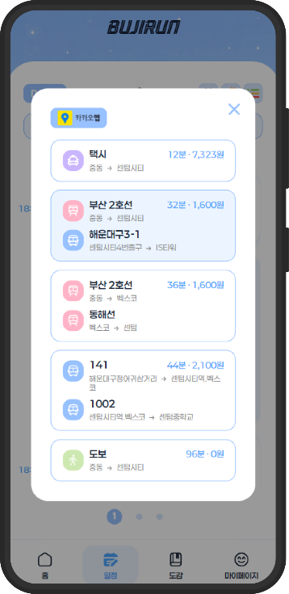
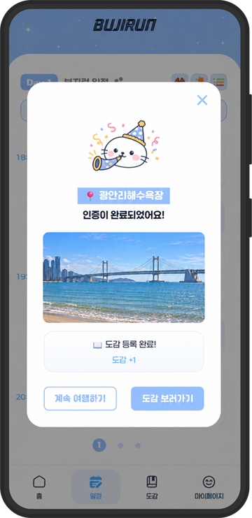
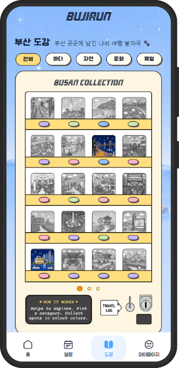
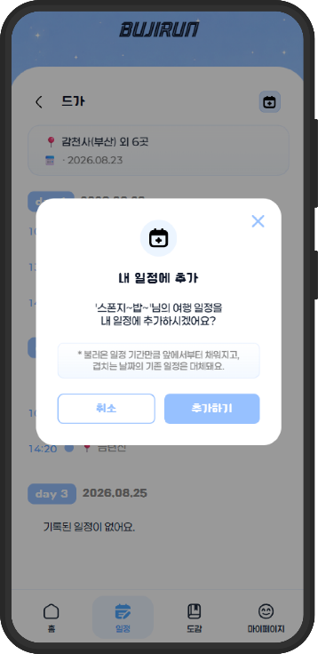
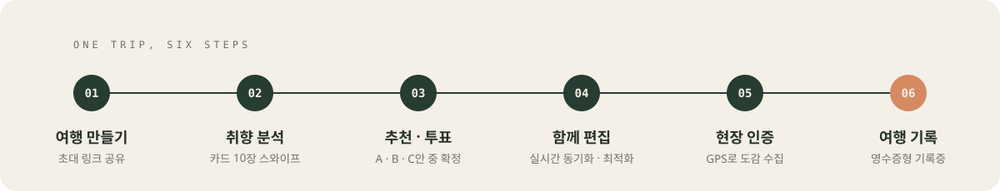
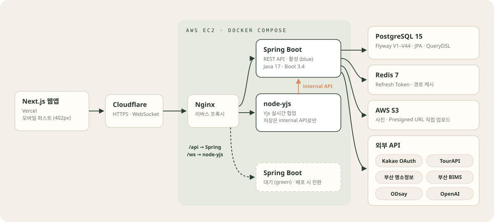

<p align="center">
  
</p>

<p align="center">
  <b>부지런</b>은 대중교통으로 부산을 함께 여행하는 사람들을 위한 모바일 웹 서비스입니다.<br/>
  관광지 카드 10장으로 모은 취향을 AI가 그룹 일정으로 만들고, 일행이 투표해 정한 뒤 실시간으로 함께 고칩니다.
</p>

<p align="center">
  <a href="https://bujirun-frontend.vercel.app"><b>서비스 열기</b></a>
  &nbsp;&nbsp;·&nbsp;&nbsp;
  <a href="#architecture">시스템 구조</a>
  &nbsp;&nbsp;·&nbsp;&nbsp;
  <a href="#engineering-highlights">기술적 구현</a>
  &nbsp;&nbsp;·&nbsp;&nbsp;
  <a href="docs/api-integration-guide.md">API 연동 가이드</a>
</p>

<br/>

## Product

<p align="center">
  
</p>

<table>
  <tr>
    <td width="33%" valign="top">
      <b>SWIPE YOUR TASTE</b><br/>
      카드 10장을 좌우로 넘기면 그룹의 취향이 모입니다.
    </td>
    <td width="33%" valign="top">
      <b>PLAN DAY BY DAY</b><br/>
      일차별 타임라인에 이동 경로와 버스 · 지하철 실시간 도착이 함께 붙습니다.
    </td>
    <td width="33%" valign="top">
      <b>KEEP THE RECEIPT</b><br/>
      다녀온 여행은 영수증 모양의 기록증으로 남습니다.
    </td>
  </tr>
</table>

<br/>

<table>
  <tr>
    <td width="33%" align="center" valign="top">
      <br/>
      <b>DECIDE TOGETHER</b><br/>
      AI가 만든 A · B안과 자유 편집 C안 중 함께 투표합니다.
    </td>
    <td width="33%" align="center" valign="top">
      <br/>
      <b>EDIT TOGETHER</b><br/>
      같은 일정을 동시에 고치고, 친구가 보고 있는 장소가 표시됩니다.
    </td>
    <td width="33%" align="center" valign="top">
      <br/>
      <b>MOVE SMARTER</b><br/>
      구간마다 버스 · 지하철 · 택시 · 도보를 시간과 요금으로 비교합니다.
    </td>
  </tr>
  <tr>
    <td width="33%" align="center" valign="top">
      <br/>
      <b>CHECK IN</b><br/>
      현장에서 GPS로 방문을 인증하고 사진을 남깁니다.
    </td>
    <td width="33%" align="center" valign="top">
      <br/>
      <b>COLLECT BUSAN</b><br/>
      인증한 명소는 부산 도감 60곳에 하나씩 채워집니다.
    </td>
    <td width="33%" align="center" valign="top">
      <br/>
      <b>BORROW A ROUTE</b><br/>
      다른 여행자의 공개 코스를 내 일정으로 가져옵니다.
    </td>
  </tr>
</table>

## Why Bujirun

**일정을 짜는 사람이 따로 없어도 되게.**
단체 여행에서 가장 미뤄지는 일은 일정 짜기입니다. 각자 카드만 넘기면 서버가 취향을 합쳐 AI 일정 후보를 만들고, 일행은 고르기만 합니다.

**같은 일정을, 같은 순간에.**
확정된 일정은 모두가 동시에 편집합니다. 누가 무엇을 바꿨는지 바로 보이고, 동시에 고쳐도 일정이 사라지지 않습니다.

**부산을 조금 더 넓게.**
부산 방문객의 약 45%가 해운대 · 광안리 · 서면 세 곳에 몰립니다<sup>[1](#ref-1)</sup>. 16개 구 · 군의 명소 60곳을 도감으로 묶고, 추천할 때 아직 가 보지 않은 도감 장소를 먼저 후보에 넣습니다.

## How It Works

<p align="center">
  
</p>

| 단계 | 사용자가 하는 일 | 이 서버가 하는 일 |
|---|---|---|
| 01 여행 만들기 | 기간 · 숙소 · 인원(2~6명)을 정하고 초대 링크를 공유 | 그룹과 초대 코드 생성, 참여 전 미리보기 제공 |
| 02 취향 분석 | 카드 10장을 좋아요 / 별로예요로 넘김 | 카테고리별 카드 배정, 결과 저장, 완료 현황 집계 |
| 03 추천 · 투표 | A · B · C안 중 투표, 방장이 확정 | OpenAI로 A · B안 생성, 투표 집계, 확정 시 도착 시각 계산 |
| 04 함께 편집 | 장소 추가 · 삭제 · 순서 · 시간 변경, AI 최적화 | 협업 서버의 저장 요청을 하루 단위로 원자적 반영, 동선 재정렬 |
| 05 현장 인증 | 도착해서 인증하고 사진 촬영 | 거리 계산으로 방문 판정, 사진 연결, 도감 갱신 |
| 06 여행 기록 | 무드 · 테마를 고르고 기록증 발행 | 종료된 일정의 로그 자동 생성, 순번 · 수집 수 · 대표 사진 계산 |

## Tech Stack

**Backend** (이 저장소) — Java 17 · Spring Boot 3.4 · Spring Security · Spring Data JPA · QueryDSL 5. 외부 API는 WebFlux `WebClient`로 호출합니다.<br/>
**Database** — PostgreSQL 15에 Flyway 마이그레이션 44개. Redis 7은 Refresh Token 저장과 경로 캐시(24시간)에 씁니다.<br/>
**Real-time** — Node.js + Yjs(CRDT) 협업 서버([Bujirun-node](https://github.com/Bujirun-dev/Bujirun-node)). 이 서버의 내부 API로만 일정을 저장합니다.<br/>
**Frontend** — Next.js 16 · React 19 · TypeScript · Tailwind CSS v4 · Zustand · TanStack Query · Kakao Map([Bujirun-frontend](https://github.com/Bujirun-dev/Bujirun-frontend)).<br/>
**Infrastructure** — AWS EC2 · S3 · ECR, Docker Compose, Nginx, Cloudflare. GitHub Actions에서 이미지를 빌드해 블루-그린으로 배포합니다.<br/>
**Data & AI** — 한국관광공사 TourAPI, 부산 명소정보 API, 부산 BIMS(버스 도착), ODsay(대중교통 경로), OpenAI(일정 생성 · 소개글 요약), Kakao OAuth.

## Architecture

<p align="center">
  
</p>

- **REST** — 웹앱의 `/api` 요청은 Nginx를 거쳐 Spring Boot로 갑니다. 공통 응답 형식은 `{ success, message, data }`입니다.
- **실시간 편집** — 웹앱은 WebSocket으로 node-yjs에 붙고, node-yjs가 변경을 모아 `PUT /api/internal/itineraries/{id}/days/{dayId}/items`로 하루치를 저장합니다. 브라우저는 일정을 직접 저장하지 않습니다.
- **사진** — 서버가 S3 Presigned URL을 발급하고, 브라우저가 S3에 바로 올립니다.
- **배포** — 쉬고 있는 색(blue / green)에 새 컨테이너를 띄우고 `/health`가 통과하면 Nginx upstream을 넘깁니다.

## Engineering Highlights

### 동시에 고쳐도 일정이 사라지지 않게

**문제** &nbsp;처음에는 브라우저마다 자기 화면 상태를 DB에 저장했습니다. 여러 명이 동시에 편집하면 늦게 도착한 옛 저장 요청이 최신 일정을 덮어써, 하루치 일정이 통째로 사라졌습니다.<br/>
**구현** &nbsp;저장 주체를 node-yjs 하나로 모으고, 하루치 항목을 한 트랜잭션에서 교체하는 내부 API를 만들었습니다. 일차마다 `version`을 두고 요청의 `expectedVersion`이 다르면 409로 거부하며, 멱등키 테이블로 같은 요청의 재전송은 한 번만 반영합니다.<br/>
**이유** &nbsp;CRDT가 화면 간 병합은 보장해도 DB 저장 순서까지 보장하지는 않습니다. 저장을 한 곳에서, 버전 비교로만 받으면 순서가 뒤바뀐 요청도 결과를 깨지 못합니다.

### AI는 한 번만, 결과는 검증해서

**문제** &nbsp;그룹원이 거의 동시에 결과 화면에 들어오면 같은 일정을 여러 번 생성하게 되고, LLM 응답은 같은 장소를 두 번 넣거나 하루를 비우기도 합니다.<br/>
**구현** &nbsp;먼저 온 요청이 투표 세션을 선점해 OpenAI를 호출하고, 나머지는 최대 55초 기다려 같은 결과를 받습니다. 후보는 좋아요한 장소의 중심에서 15 → 25 → 40km로 반경을 넓혀 최대 30곳만 넘기고, 응답이 모자라면 같은 카테고리 · 가까운 장소로 채웁니다. B안은 좌표 기반 최근접 이웃으로 다시 정렬합니다.<br/>
**이유** &nbsp;호출 비용과 대기 시간을 줄이고, 모델이 틀려도 사용자가 받는 일정의 최소 품질은 서버가 책임지게 했습니다.

### 최적화는 알고리즘 먼저, AI는 보정만

**문제** &nbsp;가까운 순서로만 돌면 도착했을 때 문을 닫은 곳이 생깁니다.<br/>
**구현** &nbsp;`PATCH /api/itineraries/days/{dayId}/optimize`는 먼저 최근접 이웃으로 순서를 정하고, 운영시간 정보를 담아 OpenAI에 순서 보정만 요청합니다. 응답이 실패하거나 해석되지 않으면 최근접 이웃 순서를 그대로 씁니다.<br/>
**이유** &nbsp;외부 AI가 응답하지 않아도 기능은 동작해야 하기 때문입니다.

### 택시를 탈지 인원수로 판단

**문제** &nbsp;4명이면 택시가 버스보다 싸고 빠를 수 있습니다.<br/>
**구현** &nbsp;부산 택시 요금(기본 4,800원/2km, 132m당 100원)에 심야 할증과 시간대별 혼잡도를 넣어 추정하고, 1인당 추가 비용이 1,000원 이하이면서 10분 이상 빠르면 택시를 대중교통보다 앞에 둡니다. 700m 이내면 도보가 먼저입니다.<br/>
**이유** &nbsp;요금은 총액 그대로 보여 주되, 추천 순서는 일행 한 명이 실제로 느끼는 비용과 시간으로 정했습니다.

### 장소마다 다른 인증 반경

**문제** &nbsp;건물 입구는 100m면 충분하지만, 넓은 공원은 중심 좌표에서 수백 m 떨어져도 그 장소 안입니다.<br/>
**구현** &nbsp;Haversine 거리로 판정하고 반경을 자연 · 공원 500m, 체험 · 놀이 200m, 역사 · 문화 · 쇼핑 100m로 나눴습니다. 인증 여부는 관광지가 아니라 일정 항목 단위로 저장합니다.<br/>
**이유** &nbsp;지난 여행에서 인증한 장소가 새 일정에서 이미 완료로 보이던 문제를 없애고, 여행마다 다시 도장을 찍게 했습니다.

<details>
<summary><b>더 보기</b> — 시간 계산, 개인정보 삭제, 데이터 파이프라인</summary>

<br/>

- **시간 계산** — `LocalTime.plusMinutes`를 누적하면 자정을 넘을 때 `00:20`처럼 돌아갑니다. 자정 차단, 마지막 날 종료 시각 상한, 같은 날 중복 시각 방지를 `ItineraryTimeUtils`에 모아 생성 · 확정 · 시작 시각 변경이 같은 규칙을 씁니다.
- **회원 탈퇴** — 즉시 익명화하고 여행 기록을 비공개로 돌립니다. 30일 안에 다시 가입하면 복구되고, 지나면 GPS 방문 기록 · 인증 사진 · 여행 로그를 매일 04:00 배치로 삭제하고 카카오 연결을 끊습니다.
- **만들다 만 여행** — 일정 확정 전 그룹이 7일 동안 활동이 없으면 매일 04:30에 정리합니다.
- **관광지 데이터** — TourAPI로 부산 관광지를 수집하고, 100m 이내 좌표와 이름이 맞는 부산 명소정보로 소개 · 휴무일 · 요금을 보완합니다. 긴 소개글은 OpenAI로 요약해 `summary_description`에 따로 저장하고 원문은 보존합니다. 관리자 API는 `/api/admin/migration/*`입니다.

</details>

<details>
<summary><b>API 목록</b> — 엔드포인트 전체</summary>

<br/>

`/api/auth/**`와 `/health`를 제외한 모든 요청에 `Authorization: Bearer {accessToken}` 헤더가 필요합니다.
자세한 명세는 Swagger UI와 [`docs/`](docs) 폴더를 참고하세요.

**인증 · 유저** — `/api/auth`, `/api/users`

| Method | Endpoint | 설명 |
|---|---|---|
| POST | `/api/auth/kakao/token` | 카카오 로그인(신규면 자동 가입) |
| POST | `/api/auth/reissue` | Access Token 재발급 |
| POST | `/api/auth/logout` | 로그아웃 |
| GET | `/api/users/me` | 내 프로필 |
| PATCH | `/api/users/me` | 닉네임·프로필 사진 수정 |
| GET | `/api/users/me/nickname/availability` | 닉네임 중복 확인 |
| DELETE | `/api/users/me` | 회원 탈퇴 |

**그룹 · 스와이프** — `/api/groups`, `/api/swipes`

| Method | Endpoint | 설명 |
|---|---|---|
| POST | `/api/groups` | 그룹 생성 |
| POST | `/api/groups/join` | 초대 코드로 참여 |
| GET | `/api/groups/me` | 내 그룹 목록 |
| GET | `/api/groups/{groupId}/members` | 그룹 멤버 |
| GET | `/api/groups/invites/{inviteCode}/preview` | 초대 미리보기 |
| POST | `/api/groups/{groupId}/flow-timers/{phase}` | 단계별 공통 타이머 |
| POST | `/api/swipes` | 스와이프 결과 제출 |
| GET | `/api/swipes/status` | 그룹 스와이프 완료 현황 |

**일정 · 생성 · 투표** — `/api/itineraries`

| Method | Endpoint | 설명 |
|---|---|---|
| POST | `/api/itineraries/generate` | 개인 일정 AI 생성(A/B/C안) |
| POST | `/api/itineraries/group/{groupId}/generate` | 그룹 일정 AI 생성 |
| POST | `/api/itineraries/vote-sessions/{id}/votes` | 투표 |
| GET | `/api/itineraries/vote-sessions/{id}` | 투표 현황 |
| POST | `/api/itineraries/vote-sessions/{id}/finalize` | 일정 확정(방장) |
| POST | `/api/itineraries` | 일정 생성 |
| GET | `/api/itineraries` | 내 일정 목록 |
| GET | `/api/itineraries/{id}` | 일정 상세 |
| PATCH | `/api/itineraries/{id}` | 일정 수정 |
| DELETE | `/api/itineraries/{id}` | 일정 삭제(개인) |
| POST | `/api/itineraries/{id}/leave` | 그룹 일정 나가기 |
| POST·DELETE | `/api/itineraries/{id}/days[/{dayId}]` | 일차 추가·삭제 |
| POST | `/api/itineraries/{id}/days/{dayId}/items` | 장소 추가 |
| PATCH·DELETE | `.../items/{itemId}` | 장소 수정·삭제 |
| PUT | `.../items` | 하루 일정 원자적 교체 |
| PATCH | `.../items/order` | 순서 일괄 변경 |
| PATCH | `.../items/{itemId}/travel-mode` | 이동수단 변경 |
| GET | `.../items/{itemId}/travel-mode/options` | 이동수단 후보 |
| PATCH | `/api/itineraries/days/{dayId}/optimize` | 동선 최적화 |
| PUT | `/api/internal/itineraries/{id}/days/{dayId}/items` | (내부) 협업 서버 저장 |

**교통** — `/api/transit`

| Method | Endpoint | 설명 |
|---|---|---|
| GET | `/api/transit/arrival/bus` | 버스 실시간 도착 |
| GET | `/api/transit/arrival/subway` | 지하철 다음 열차까지 남은 시간 |

**관광지 · 북마크 · 도감 · 방문**

| Method | Endpoint | 설명 |
|---|---|---|
| GET | `/api/spots/search` | 관광지 검색 |
| GET | `/api/spots/{spotId}` | 관광지 상세 |
| GET·POST·DELETE | `/api/bookmarks[/{spotId}]` | 북마크 |
| GET | `/api/collections` | 도감 목록 |
| GET | `/api/collections/my` | 내 수집 현황 |
| GET | `/api/collections/category` | 카테고리별 도감 |
| GET | `/api/collections/swipe-deck` | 스와이프 덱 |
| GET·DELETE | `/api/collections/{spotId}` | 도감 상세·삭제 |
| POST | `/api/visits` | GPS 방문 인증 |
| POST | `/api/visits/{visitId}/photos` | 인증 사진 첨부 |
| GET | `/api/visits` | 방문 인증 이력 |

**여행 로그** — `/api/logs`

| Method | Endpoint | 설명 |
|---|---|---|
| POST | `/api/logs` | 로그 생성 |
| GET | `/api/logs/me` | 내 로그 목록 |
| GET | `/api/logs/{id}` | 로그 상세 |
| PATCH·DELETE | `/api/logs/{id}` | 수정·삭제 |
| GET | `/api/logs/exists` | 일정별 로그 존재 여부(+자동 생성) |
| POST·DELETE | `/api/logs/receipt-prompt/{itineraryId}/dismiss` | 영수증 팝업 "다시 묻지 않음" |
| GET | `/api/logs/public` | 공개 로그 피드 |
| GET | `/api/logs/spot/{spotId}` | 관광지별 로그 |
| POST | `/api/logs/{id}/copy` | 내 일정으로 복사 |
| POST | `/api/logs/{id}/imports` | 불러오기 횟수 증가 |
| POST·DELETE | `/api/logs/{logId}/items/{itemId}/photos[/{photoId}]` | 사진 |
| PATCH | `.../photos/{photoId}/representative` | 대표 사진 지정 |
| POST·DELETE | `/api/logs/{logId}/items/{itemId}/hashtags[/{id}]` | 해시태그 |

**업로드 · 관리자 · 헬스체크**

| Method | Endpoint | 설명 |
|---|---|---|
| POST | `/api/uploads/presign` | S3 Presigned URL 발급 |
| POST·GET | `/api/admin/migration/{run,status}` | TourAPI 수집 |
| POST·GET | `/api/admin/migration/busan-attraction/*` | 부산 명소정보 병합·요약 |
| POST·GET | `/api/admin/migration/tourapi-overview/*` | 개요 백필·AI 요약 |
| POST·GET | `/api/admin/migration/official-recommended/*` | 공식 추천 관광지 |
| GET | `/health` | 서버 상태 |

</details>

<details>
<summary><b>프로젝트 구조</b></summary>

<br/>

```
src/main/java/com/bujirun/bujirun
├── domain
│   ├── auth          # 카카오 로그인, JWT, 유저, 회원탈퇴 배치
│   ├── group         # 여행 그룹, 초대, 공통 타이머, 이탈 여행 정리 배치
│   ├── swipe         # 스와이프 결과 · 그룹 완료 현황
│   ├── itinerary
│   │   ├── generate  # AI 일정 생성, 경로/택시요금/버스·지하철 도착
│   │   ├── optimize  # 동선 최적화
│   │   └── vote      # A/B/C 투표 · 확정
│   ├── spot          # 관광지 검색/상세, 공공데이터 마이그레이션
│   ├── collection    # 부산 도감
│   ├── visit         # GPS 방문 인증 · 인증 사진
│   ├── log           # 여행 로그(영수증) · 사진 · 해시태그
│   ├── bookmark      # 북마크
│   └── upload        # S3 Presigned URL
└── global
    ├── config        # Security, Redis, Cache, WebClient, Swagger
    ├── jwt           # JWT 필터 · 발급
    ├── internal      # 협업 서버용 내부 인증
    ├── exception     # 전역 예외 처리
    └── response      # 공통 응답 포맷
src/main/resources/db/migration   # Flyway V1 ~ V44
docs/                             # 프론트 연동 가이드, 일정·방문 API 명세
```

</details>

## Getting Started

**요구 환경** &nbsp;JDK 17, PostgreSQL 15, Redis 7 (Docker로 띄우는 것을 권장)

```bash
git clone https://github.com/Bujirun-dev/Bujirun-backend.git
cd Bujirun-backend

# DB와 Redis — 저장소의 docker-compose.yml은 서버 전용이라 커밋되어 있지 않습니다
docker run -d --name bujirun-db -p 5432:5432 \
  -e POSTGRES_DB=bujirun -e POSTGRES_USER=bujirun -e POSTGRES_PASSWORD=bujirun postgres:15
docker run -d --name bujirun-redis -p 6379:6379 redis:7
```

환경 변수를 셸에 설정합니다. DB · Redis는 위 값과 같으면 생략해도 기본값으로 붙습니다. `bootRun`은 `.env` 파일을 자동으로 읽지 않습니다.

```dotenv
JWT_SECRET=
KAKAO_CLIENT_ID=
KAKAO_CLIENT_SECRET=
KAKAO_REDIRECT_URI=http://localhost:3000/auth/kakao/callback
KAKAO_ADMIN_KEY=
INTERNAL_API_SECRET=          # node-yjs → 내부 API 인증
TOURAPI_SERVICE_KEY=
BUSAN_ATTRACTION_API_SERVICE_KEY=
BUSAN_API_KEY=                # 부산 BIMS 버스 도착
ODSAY_API_KEY=
OPENAI_API_KEY=
GROQ_API_KEY=
AWS_REGION=ap-northeast-2
AWS_S3_BUCKET=bujirun-storage # AWS 자격 증명은 기본 credential chain에서 읽습니다
```

```bash
./gradlew bootRun     # http://localhost:8080 · Swagger /swagger-ui/index.html · 헬스체크 /health
./gradlew test        # @SpringBootTest가 있어 DB · Redis와 환경 변수가 필요합니다
```

스키마는 애플리케이션 시작 시 Flyway가 자동으로 만듭니다(`ddl-auto: validate`).

## Related

[Bujirun-frontend](https://github.com/Bujirun-dev/Bujirun-frontend) — Next.js 모바일 웹앱 &nbsp;·&nbsp;
[Bujirun-node](https://github.com/Bujirun-dev/Bujirun-node) — Yjs 실시간 협업 서버

<a id="ref-1"></a><sub>[1] 부산관광공사, 「2023년 주요 관광지 심층 분석」(KT 빅데이터 기반). 2026 관광데이터 활용 공모전 기능설명서 인용.</sub>

<br/><br/>

<p align="center">
  <br/>
  <b>부지런히 다니고, 부지런히 모으고, 부지런히 남기자.</b><br/>
  <a href="https://bujirun-frontend.vercel.app">bujirun-frontend.vercel.app</a>
</p>
