<div align="center">


# 부지런 BUJIRUN — Backend

**카드 몇 장 넘기면, 친구들과 함께 갈 부산 여행 일정이 완성됩니다.**

<sub>스와이프 취향 분석 · AI 일정 추천 · 실시간 공동 편집 · 이동수단 비교 · GPS 도감 수집 · 여행 기록증</sub>

<br/>

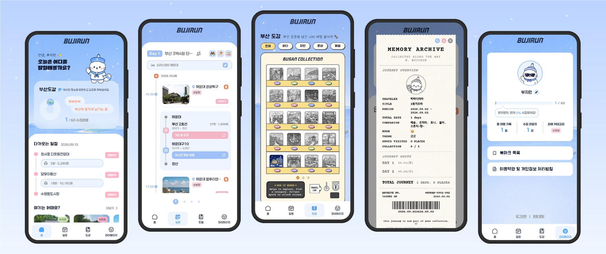

<br/>


🧭 [**서비스 바로가기**](https://bujirun-frontend.vercel.app) &nbsp;·&nbsp;
🛰️ API `https://api.bujirun.store` &nbsp;·&nbsp;
📖 Swagger `/swagger-ui/index.html`

<sub>2026 관광데이터 활용 공모전 · 웹앱 개발 부문</sub>

</div>

<br/>

## 📍 목차

1. [부지런은 어떤 서비스인가요?](#-부지런은-어떤-서비스인가요)
2. [핵심 기능 — 화면으로 보기](#-핵심-기능--화면으로-보기)
3. [시스템 구조](#-시스템-구조)
4. [기술 스택](#-기술-스택)
5. [API 한눈에 보기](#-api-한눈에-보기)
6. [프로젝트 구조](#-프로젝트-구조)
7. [로컬에서 실행하기](#-로컬에서-실행하기)
8. [배포](#-배포)
9. [기술적으로 고민한 것들](#-기술적으로-고민한-것들)

<br/>

## 🐚 부지런은 어떤 서비스인가요?

> **"다들 어디 가고 싶어?" — "아무 데나~"** … 그리고 아무도 일정을 짜지 않는다.

부지런은 **대중교통으로 부산을 함께 여행하는 2030 동행자**를 위한 웹앱입니다.
관광지 카드를 좌우로 넘기는 것만으로 각자의 취향을 모으고, AI가 그룹 일정을 추천하고, 다 같이 투표해서 정하고, 실시간으로 함께 고칩니다.
여행지에서는 GPS로 방문을 인증해 **부산 도감**을 채우고, 여행이 끝나면 **영수증 모양의 여행 기록증**으로 남깁니다.

해운대·광안리·서면에 몰리는 관광 수요를 부산 16개 구·군의 다양한 명소로 넓히는 것도 목표입니다. 그래서 도감 60곳을 바다·자연·문화·체험으로 고르게 골랐고, 일정 추천도 **아직 모으지 않은 도감 장소**를 먼저 후보에 넣습니다.

<table>
<tr>
<td align="center" width="20%">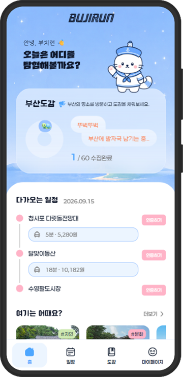<br/><b>🏠 홈</b><br/><sub>다가오는 일정 · 도감 진행률<br/>· 관광지 추천</sub></td>
<td align="center" width="20%">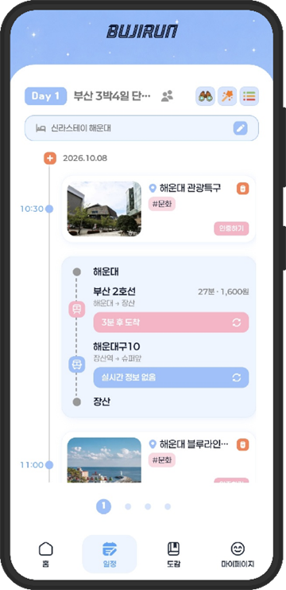<br/><b>🗓️ 일정</b><br/><sub>일차별 타임라인<br/>· 이동수단 · 실시간 도착</sub></td>
<td align="center" width="20%">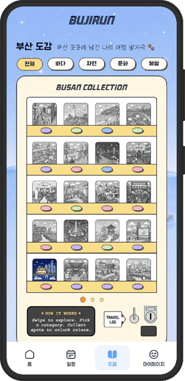<br/><b>📒 도감</b><br/><sub>부산 도감 자판기<br/>· 바다·자연·문화·체험</sub></td>
<td align="center" width="20%">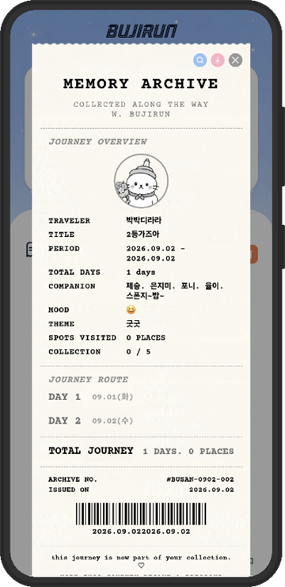<br/><b>🧾 여행 기록증</b><br/><sub>MEMORY ARCHIVE<br/>영수증형 기록</sub></td>
<td align="center" width="20%">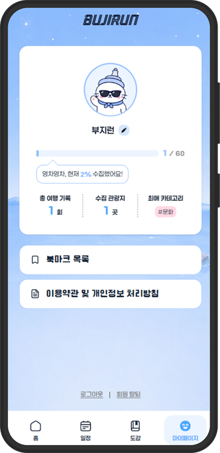<br/><b>👤 마이페이지</b><br/><sub>여행 통계 · 북마크<br/>· 프로필</sub></td>
</tr>
</table>

<div align="center">

| 🏝️ 부산 관광지 | 📒 도감 수집 대상 | 🗺️ 도감 카테고리 | 👥 그룹 인원 | 🗓️ 최대 여행 기간 |
|:---:|:---:|:---:|:---:|:---:|
| **299곳** | **60곳** | 🌊 바다 · 🌲 자연 · 🏛️ 문화 · 🎡 체험 | **2~6명** | **3박 4일** |

</div>

### 🧳 여행 한 번의 흐름

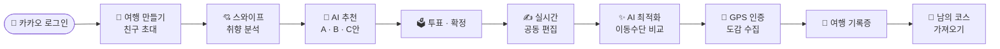

<br/>

## 📱 핵심 기능 — 화면으로 보기

> 각 기능마다 **실제 앱 화면**과 그 뒤에서 **백엔드가 하는 일**을 함께 정리했습니다.

---

### ① 스와이프 취향 분석 → AI 맞춤 일정 생성

<table>
<tr>
<td align="center">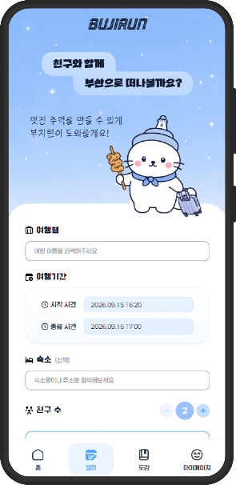<br/><sub><b>1. 여행 만들기</b><br/>여행명·기간·숙소·친구 수</sub></td>
<td align="center">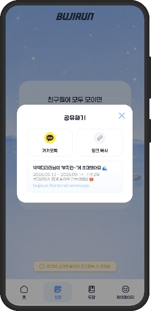<br/><sub><b>2. 친구 초대</b><br/>카카오톡 · 링크 복사</sub></td>
<td align="center">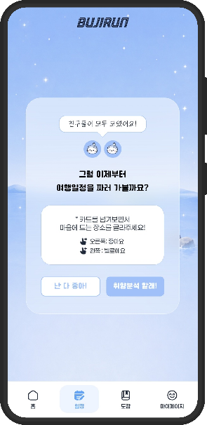<br/><sub><b>3. 참여 선택</b><br/>「취향분석 할래!」/「난 다 좋아!」</sub></td>
<td align="center">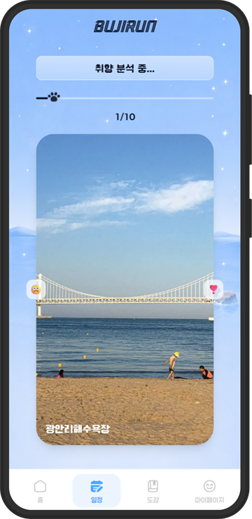<br/><sub><b>4. 스와이프</b><br/>← 별로예요 · 좋아요 →</sub></td>
<td align="center">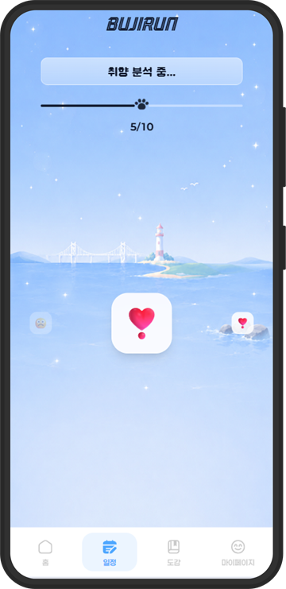<br/><sub><b>5. 10장 완료</b><br/>취향 분석 중…</sub></td>
</tr>
<tr>
<td align="center"><br/><sub><b>6. A안 · 취향 집중형</b><br/>「부지런이 추천해요!」</sub></td>
<td align="center">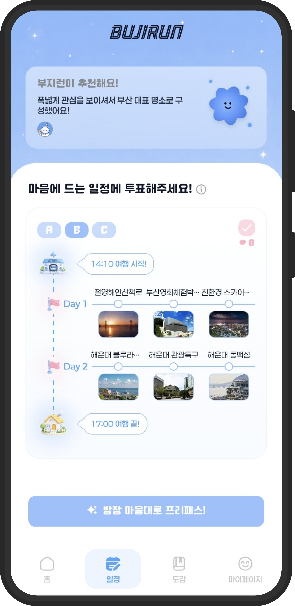<br/><sub><b>7. B안 · 균형형</b><br/>여러 취향을 고르게</sub></td>
<td align="center">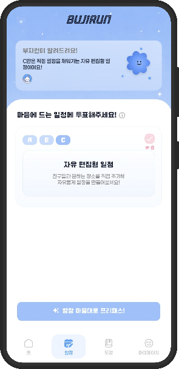<br/><sub><b>8. C안 · 자유 편집형</b><br/>빈 틀에서 직접 구성</sub></td>
<td align="center">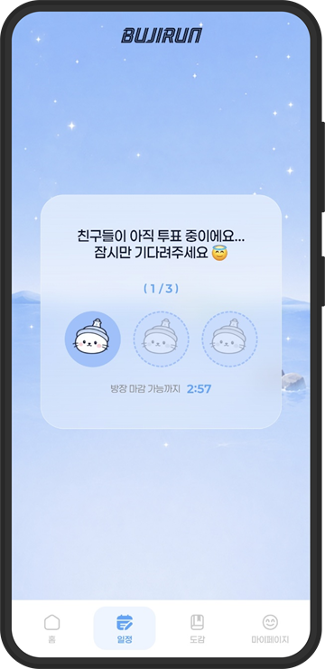<br/><sub><b>9. 투표 대기</b><br/>방장 마감까지 카운트다운</sub></td>
<td align="center">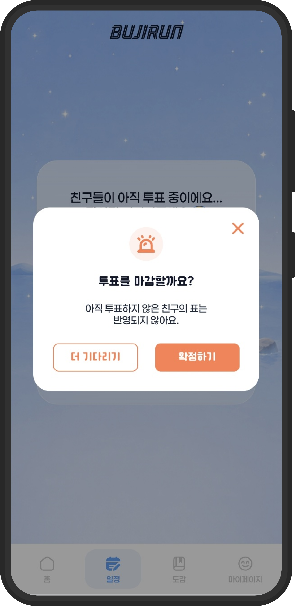<br/><sub><b>10. 투표 마감</b><br/>방장이 확정</sub></td>
</tr>
</table>

**백엔드가 하는 일**

| 단계 | 처리 내용 | API |
|---|---|---|
| 여행·초대 | 그룹과 초대 코드를 만들고, 링크로 들어온 친구에게 여행명·초대자·인원/정원(2~6명)을 미리 보여줍니다. | `POST /api/groups`<br/>`GET /api/groups/invites/{code}/preview`<br/>`POST /api/groups/join` |
| 스와이프 | 도감 카테고리별로 배정한 관광지 카드 10장을 내려주고, 좋아요/별로예요 결과를 한 번에 저장합니다. 누가 끝냈는지도 알려줍니다. | `GET /api/collections/swipe-deck`<br/>`POST /api/swipes`<br/>`GET /api/swipes/status` |
| 공통 타이머 | 취향 분석·투표 마감처럼 모두가 같은 카운트다운을 봐야 하는 단계는 **서버 시각 기준**의 마감 시각을 내려줘서, 기기마다 시계가 달라도 어긋나지 않습니다. | `POST /api/groups/{id}/flow-timers/{phase}` |
| AI 추천 | 그룹 취향을 합쳐 **OpenAI**로 A·B안을 만들고 C안(빈 틀)을 붙입니다. 코스 요약과 장소별 추천 이유도 함께 만듭니다. | `POST /api/itineraries/group/{groupId}/generate` |
| 투표·확정 | 최다 득표안으로 확정하고, 동률이면 방장이 고릅니다. 투표가 늦어지면 3분 뒤 방장이 마감할 수 있고, **프리패스**로 원하는 안을 바로 고를 수도 있습니다. | `POST .../vote-sessions/{id}/votes`<br/>`POST .../vote-sessions/{id}/finalize` |

<details>
<summary><b>🔍 AI 일정이 엉뚱하게 나오지 않도록 서버가 잡아주는 것들</b></summary>

<br/>

- 🎯 **후보 추리기** — 좋아요한 장소의 중심점에서 15km → 25km → 40km로 반경을 넓혀 최소 20곳을 확보하고, 같은 카테고리 후보를 합쳐 최대 30곳만 AI에 넘깁니다. 아직 모으지 않은 도감 장소를 먼저 넣습니다.
- 🧊 **콜드 스타트** — 모두 "난 다 좋아!"를 골라 좋아요가 없으면 구·군별로 고르게 돌아가며 뽑아, 한 동네에 몰리지 않게 합니다.
- 🔀 **다양성** — A안과 B안은 최소 3곳 이상 달라야 합니다.
- 🧭 **B안 동선** — AI 순서 대신 좌표 기반 최근접 이웃 알고리즘으로 다시 정렬합니다.
- 🩹 **자동 보충** — AI가 하루치를 덜 채우면 좋아요한 곳과 비슷한(같은 카테고리·가까운) 장소로 채웁니다.
- 🔒 **AI는 한 번만** — 그룹원이 동시에 결과 화면에 들어와도 먼저 온 요청만 AI를 호출하고, 나머지는 최대 55초까지 기다렸다가 같은 결과를 받습니다.
- ⏰ **시각 채우기** — 확정 시 `시작 시각 + 체류 + 이동 시간`으로 도착 시각을 쌓되, 자정을 넘기지 않고 마지막 날 종료 시각과 같은 날 중복 시각을 피합니다.

</details>

---

### ② 실시간 공동 일정 편집

<table>
<tr>
<td align="center" width="50%"><br/><sub><b>누가 어디를 보고 있는지</b><br/>보고 있는 관광지에 친구 프로필이 실시간 표시</sub></td>
<td align="center" width="50%">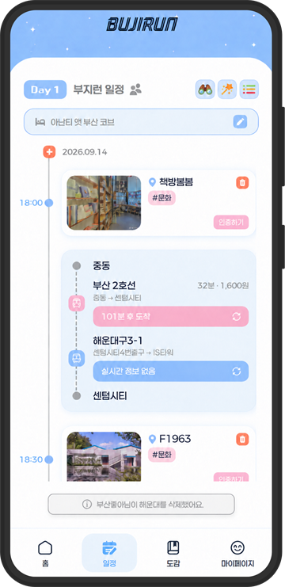<br/><sub><b>새로고침 없이 바로 반영</b><br/>「OO님이 해운대를 추가했어요」 같은 알림</sub></td>
</tr>
</table>

그룹원이 장소를 추가·삭제하거나 시간을 바꾸면 모두의 화면에 즉시 반영됩니다. 동기화는 별도의 **Node.js + Yjs(CRDT) 협업 서버**가 맡고, **DB 저장은 그 Node 서버만** 백엔드 내부 API로 합니다.

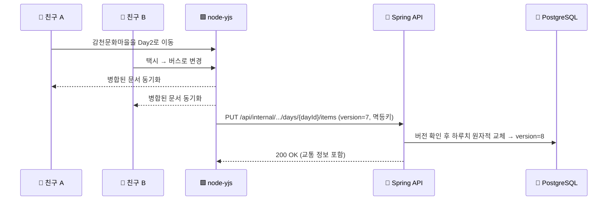

- **일차별 낙관적 락**(`day.version`) — 늦게 도착한 옛 저장 요청이 최신 일정을 덮어쓰지 못합니다.
- **멱등키** — 같은 저장 요청이 재전송돼도 한 번만 반영됩니다.
- **하루 최대 10곳** 제한은 동시에 추가할 때도 서버에서 지킵니다.

| 편집 기능 | API |
|---|---|
| 일차 추가 / 삭제 | `POST·DELETE /api/itineraries/{id}/days` |
| 관광지 추가 / 시간 변경 / 삭제 | `POST·PATCH·DELETE .../days/{dayId}/items` |
| 순서 한 번에 바꾸기 | `PATCH .../items/order` |
| 하루 일정 원자적 교체 (협업 서버 전용) | `PUT /api/internal/itineraries/{id}/days/{dayId}/items` |
| 숙소 등록 · 여행 정보 수정 | `PATCH /api/itineraries/{id}` |
| 여행 삭제 / 그룹 여행 나가기 | `DELETE /api/itineraries/{id}` · `POST .../leave` |

---

### ③ AI 일정 최적화 & 이동수단 비교

<table>
<tr>
<td align="center">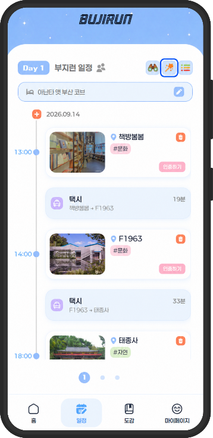<br/><sub><b>1. 최적화 실행</b><br/>상단 ✨ 버튼</sub></td>
<td align="center">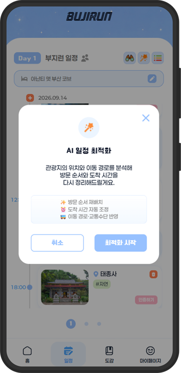<br/><sub><b>2. AI 일정 최적화</b><br/>순서·시간·이동수단 재정리</sub></td>
<td align="center">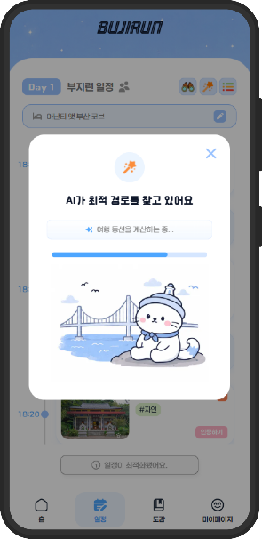<br/><sub><b>3. 최적 경로 탐색</b><br/>이동 동선 계산 중</sub></td>
<td align="center">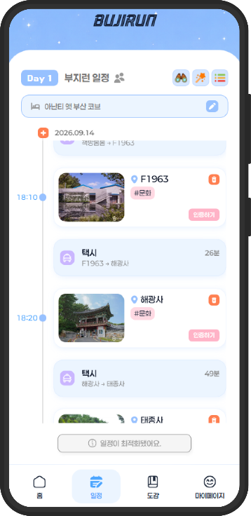<br/><sub><b>4. 결과 반영</b><br/>「일정이 최적화됐어요」</sub></td>
</tr>
<tr>
<td align="center">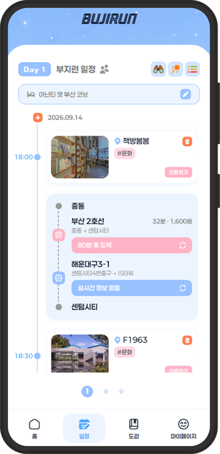<br/><sub><b>5. 구간별 이동</b><br/>지하철 · 버스 실시간 도착</sub></td>
<td align="center">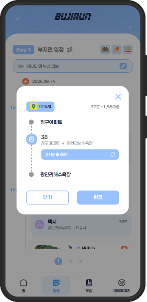<br/><sub><b>6. 경로 상세</b><br/>카카오맵 연결</sub></td>
<td align="center"><br/><sub><b>7. 수단 비교</b><br/>택시·지하철·버스·도보</sub></td>
<td align="center">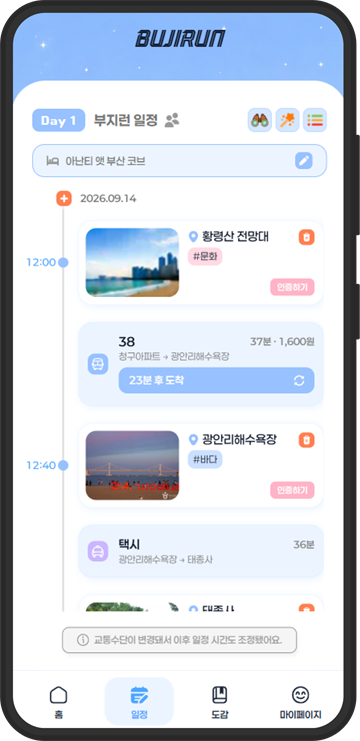<br/><sub><b>8. 수단 변경</b><br/>이후 일정 시간 자동 조정</sub></td>
</tr>
</table>

**백엔드가 하는 일**

- ✨ **최적화** — 관광지 좌표를 기준으로 가까운 곳을 이어 방문하도록 순서를 다시 정렬하고, 운영시간을 반영해 도착 예정 시각과 이동 경로를 다시 계산합니다. `PATCH /api/itineraries/days/{dayId}/optimize`
- 🚇 **대중교통** — ODsay로 구간별 경로를 찾고, 버스는 **부산 BIMS** 실시간 도착 정보를 붙입니다. 경로는 Redis에 24시간 캐싱하고, 도착 정보는 매번 새로 가져옵니다. `GET /api/transit/arrival/{bus,subway}`
- 🚕 **택시** — 부산 택시 요금(기본 4,800원/2km, 132m당 100원)에 심야 할증(23~24시 20%, 0~2시 30%, 2~4시 20%)과 시간대별 혼잡도를 반영해 추정합니다.
- 👥 **인원수까지 고려한 정렬** — 택시비를 인원으로 나눠 1인당 추가 비용이 1,000원 이하이면서 10분 이상 빠르면 택시를 대중교통보다 앞에 둡니다. 700m 이내면 도보를 맨 앞에 둡니다.
- 🔁 **수단 변경** — 한 구간만 바꾸고 나머지 구간 선택은 그대로 둡니다. `PATCH .../items/{itemId}/travel-mode`

```http
GET /api/transit/arrival/bus?arsId=09029&routeNo=1003
→ { "success": true, "message": "OK", "data": 4 }   // 화면: "4분 후 도착"
```

---

### ④ GPS 방문 인증 · 도감 수집 · 여행 기록증

<table>
<tr>
<td align="center">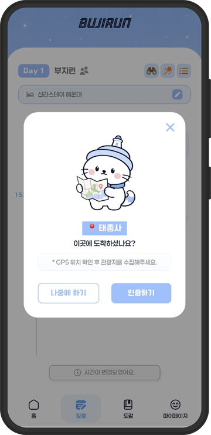<br/><sub><b>1. 도착 인증</b><br/>「이곳에 도착하셨나요?」</sub></td>
<td align="center">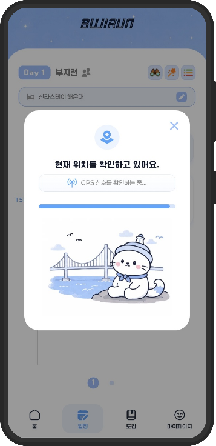<br/><sub><b>2. 위치 확인</b><br/>GPS 신호 확인 중</sub></td>
<td align="center">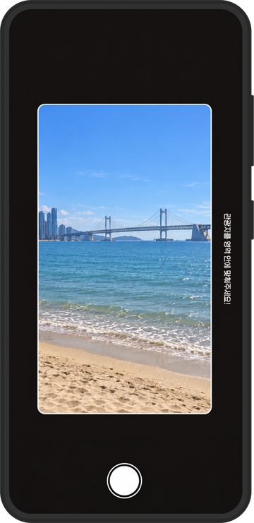<br/><sub><b>3. 현장 촬영</b><br/>인-앱 카메라</sub></td>
<td align="center"><br/><sub><b>4. 인증 완료</b><br/>도감 등록 완료 · 도감 +1</sub></td>
<td align="center"><br/><sub><b>5. 도감 채우기</b><br/>흑백 카드가 컬러로</sub></td>
</tr>
<tr>
<td align="center">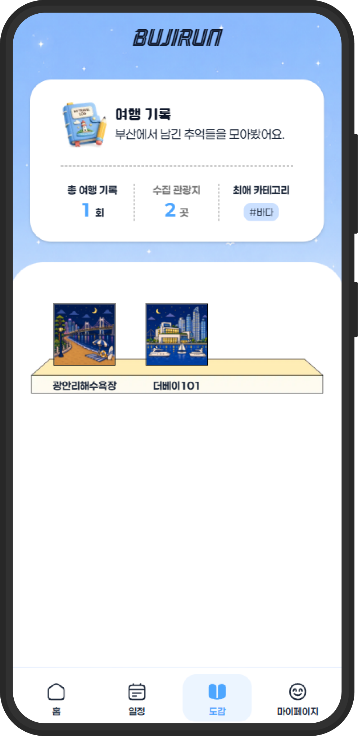<br/><sub><b>6. 여행 기록</b><br/>수집한 관광지 선반</sub></td>
<td align="center">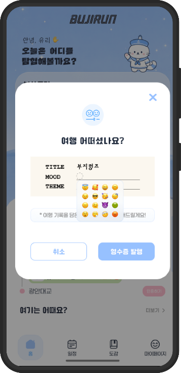<br/><sub><b>7. 여행 어떠셨나요?</b><br/>무드 이모지 · 테마 선택</sub></td>
<td align="center"><br/><sub><b>8. 여행 기록증 발행</b><br/>이미지로 저장</sub></td>
<td align="center">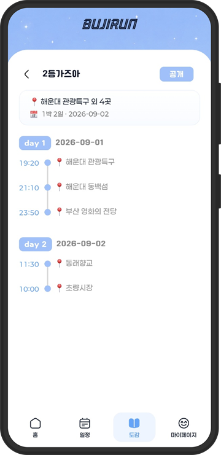<br/><sub><b>9. 공개</b><br/>다른 여행자에게 공유</sub></td>
<td align="center">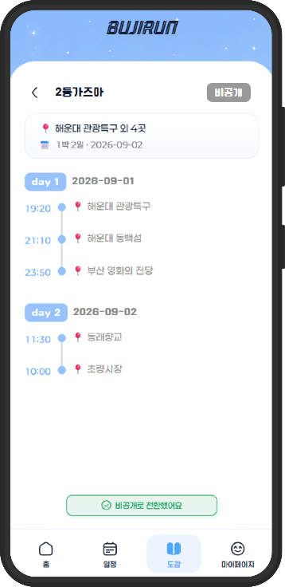<br/><sub><b>10. 비공개</b><br/>「비공개로 전환했어요」</sub></td>
</tr>
</table>

**GPS 인증** — 서버가 현재 위치와 관광지 좌표 사이 거리를 **Haversine 공식**으로 계산합니다. 넓은 공원과 건물 입구는 같은 기준으로 볼 수 없어서, 카테고리마다 인증 반경이 다릅니다.

| 카테고리 | 인증 반경 | 예시 |
|---|:---:|---|
| 🌲 자연·공원 | **500m** | 해운대 동백섬, 회동수원지 |
| 🎡 체험·놀이 | **200m** | 대항 어촌체험 휴양마을 |
| 🏛️ 역사·문화 · 🛍️ 쇼핑 | **100m** | F1963, UN조각공원, 구포시장 |

```http
POST /api/visits
{ "tourSpotId": "5f66f31b-...", "itineraryItemId": "a1b2...", "gpsLat": 35.1587, "gpsLng": 129.1604 }
→ { "visitId": "5ce19ea1-...", "verified": true, "distanceMeters": 47.3 }
```

- 인증하면 사진은 **S3 Presigned URL**로 브라우저에서 바로 올리고(`POST /api/uploads/presign`), 방문에 연결합니다(`POST /api/visits/{id}/photos`).
- 인증 여부는 **일정 항목 단위**로 저장합니다. 지난 여행에서 인증한 곳도 새 여행에서는 다시 도장을 찍습니다.
- 도감 수집 현황은 `GET /api/collections/my`, 카테고리별 도감은 `GET /api/collections/category`로 내려줍니다.

**여행 기록증(로그)**

| 기록증 항목 | 백엔드에서 채우는 값 |
|---|---|
| 자동 생성 | 여행이 끝나면 기록증 발행 여부와 상관없이 **비공개 로그를 자동 생성**합니다. 프론트는 무드·테마만 `PATCH /api/logs/{id}`로 채웁니다. (`GET /api/logs/exists`) |
| `ARCHIVE NO.` | 몇 번째 여행인지(`travelNumber`)를 생성 시점에 확정해 저장합니다. |
| `COLLECTION 4 / 60` | 이번 여행에서 인증한 도감 장소 수(`collectedSpots`)입니다. |
| 대표 사진 | 인증 사진 중 하나로 정하고, 없으면 일정의 첫 관광지 사진을 씁니다. |
| 팝업 "다시 묻지 않음" | 일정마다 기록증 팝업을 끌 수 있습니다. (`POST·DELETE /api/logs/receipt-prompt/{itineraryId}/dismiss`) |
| 공개 / 비공개 | 공개한 로그만 로그 둘러보기와 관광지별 관련 기록에 나옵니다. |

---

### ⑤ 관광지 AI 요약 & 여행 코스 가져오기

<table>
<tr>
<td align="center">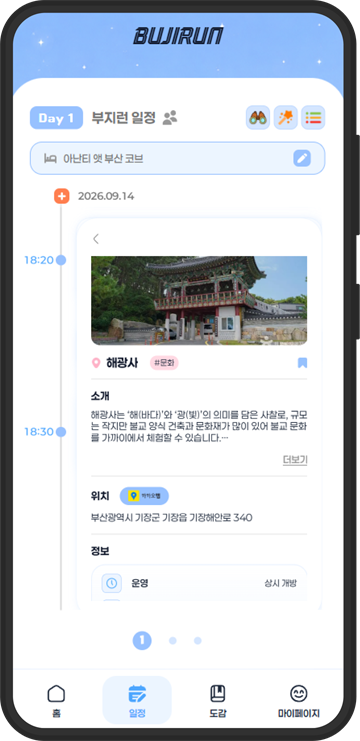<br/><sub><b>1. 관광지 정보</b><br/>AI 요약 소개 · 운영정보</sub></td>
<td align="center">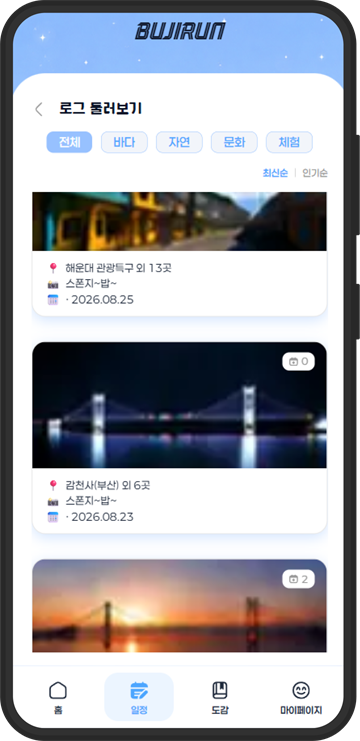<br/><sub><b>2. 로그 둘러보기</b><br/>카테고리 · 최신순/인기순</sub></td>
<td align="center">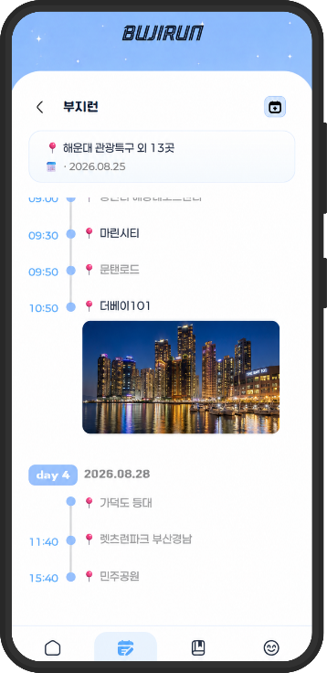<br/><sub><b>3. 남의 여행 코스</b><br/>일차별 장소와 사진</sub></td>
<td align="center"><br/><sub><b>4. 내 일정에 추가</b><br/>겹치는 날은 대체</sub></td>
</tr>
</table>

- 📝 **AI 요약** — TourAPI·부산 명소정보의 긴 소개글을 OpenAI로 요약해 `summary_description`에 저장합니다. 원문은 따로 보존합니다. `GET /api/spots/{spotId}`
- 🔎 **검색 · 추천순** — 키워드·구·군·카테고리로 찾고, 추천순은 ① 도감 대상 → ② 아직 안 모은 곳 → ③ 내가 가장 많이 간 카테고리 → ④ 나머지 순서입니다. `GET /api/spots/search`
- 🧳 **관련 여행 기록** — 그 장소를 다녀간 공개 로그를 보여줍니다. `GET /api/logs/spot/{spotId}` · 피드는 `GET /api/logs/public`
- 🔁 **코스 가져오기** — 고른 코스를 내 여행 첫날부터 일차별로 옮기고(겹치는 날은 대체), 원본 로그의 불러온 횟수를 올립니다. `POST /api/logs/{id}/copy` · `POST /api/logs/{id}/imports`
- 🔖 **북마크** — 마음에 드는 관광지를 마이페이지 북마크 목록에 모읍니다. `/api/bookmarks`

---

### 🔐 그 밖의 기능

- **카카오 로그인 = 회원가입** — 인가 코드 한 번으로 가입·로그인합니다. Access Token 30분, Refresh Token 2주(`HttpOnly` 쿠키 + Redis). 닉네임은 바꾸기 전에 중복 확인을 합니다.
- **회원 탈퇴** — 즉시 익명화하고 여행 기록을 비공개로 돌립니다. 30일 안에 다시 가입하면 복구되고, 지나면 GPS 방문 기록·인증 사진·여행 로그까지 매일 04:00 배치로 완전히 지우고 카카오 연결도 끊습니다.
- **만들다 만 여행 정리** — 일정 확정 전 그룹이 7일 동안 활동이 없으면 매일 04:30에 정리합니다.
- **관광지 데이터 파이프라인(관리자)** — 여러 공공 데이터를 합쳐 관광지 DB를 만듭니다.

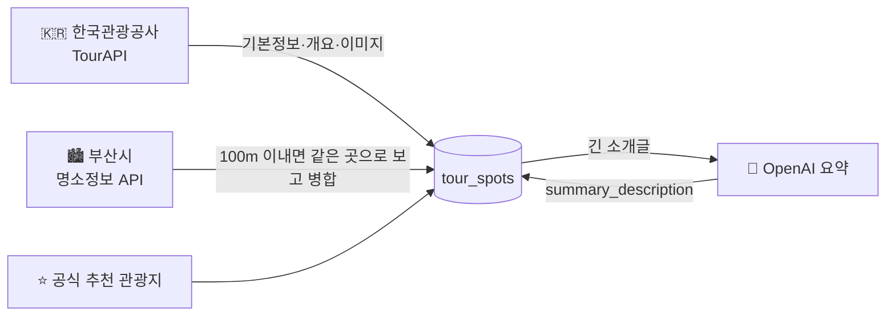

<br/>

## 🏗️ 시스템 구조

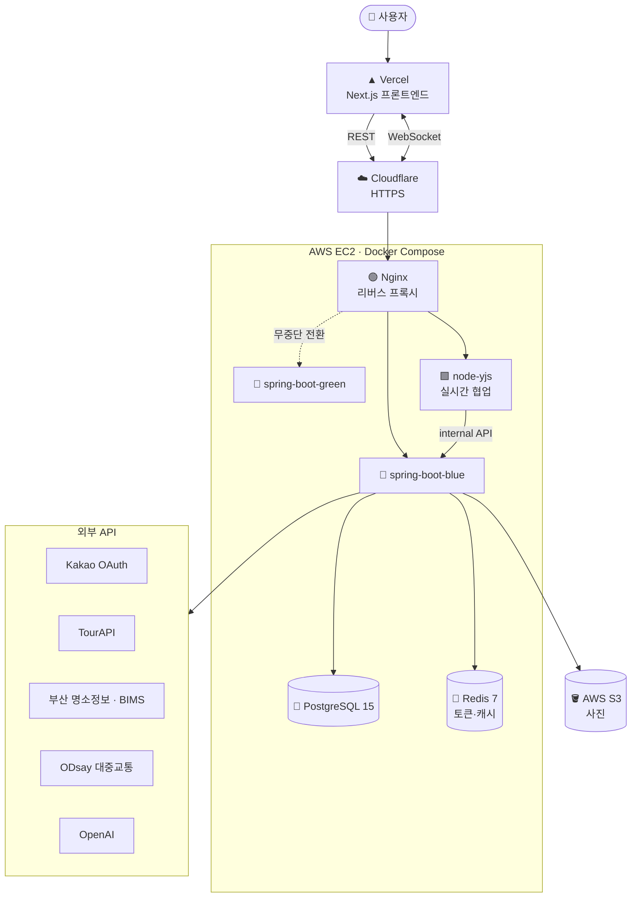

---

## 🧰 기술 스택

| 분야 | 사용 기술 |
|---|---|
| **Language / Framework** | Java 17, Spring Boot 3.4, Spring Web, Spring WebFlux(`WebClient`로 외부 API 비동기 호출) |
| **Data** | Spring Data JPA, QueryDSL 5, PostgreSQL 15, Flyway(마이그레이션 44개) |
| **Cache / Session** | Redis 7(Refresh Token 저장), Spring Cache(경로 24시간 · 지하철 시간표 5분 TTL) |
| **Auth** | Spring Security, JWT(`java-jwt`), Kakao OAuth 2.0 |
| **Storage** | AWS S3 Presigned URL(AWS SDK v2) |
| **AI** | OpenAI(일정 생성 · 소개글 요약), Groq |
| **Realtime** | Node.js + Yjs 협업 서버(별도 저장소) ↔ Spring 내부 API |
| **Infra** | AWS EC2, ECR, Docker Compose, Nginx, Cloudflare |
| **CI/CD** | GitHub Actions → ECR push → SSH → 블루-그린 배포 스크립트 |
| **Quality** | JUnit 5, JaCoCo, SonarQube |
| **Docs** | springdoc-openapi(Swagger UI) |

---

## 📡 API 한눈에 보기

> 모든 응답은 `{ "success": true, "message": "OK", "data": { ... } }` 형식으로 감쌉니다.
> `/api/auth/**`와 `/health`를 제외한 모든 요청에 `Authorization: Bearer {accessToken}` 헤더가 필요합니다.
> 자세한 명세는 Swagger UI와 [`docs/`](docs) 폴더를 참고하세요.

<details>
<summary><b>🔐 인증 · 유저</b> — <code>/api/auth</code>, <code>/api/users</code></summary>

| Method | Endpoint | 설명 |
|---|---|---|
| POST | `/api/auth/kakao/token` | 카카오 로그인(신규면 자동 가입) |
| POST | `/api/auth/reissue` | Access Token 재발급 |
| POST | `/api/auth/logout` | 로그아웃 |
| GET | `/api/users/me` | 내 프로필 |
| PATCH | `/api/users/me` | 닉네임·프로필 사진 수정 |
| GET | `/api/users/me/nickname/availability` | 닉네임 중복 확인 |
| DELETE | `/api/users/me` | 회원 탈퇴 |
</details>

<details>
<summary><b>👥 그룹 · 💘 스와이프</b> — <code>/api/groups</code>, <code>/api/swipes</code></summary>

| Method | Endpoint | 설명 |
|---|---|---|
| POST | `/api/groups` | 그룹 생성 |
| POST | `/api/groups/join` | 초대 코드로 참여 |
| GET | `/api/groups/me` | 내 그룹 목록 |
| GET | `/api/groups/{groupId}/members` | 그룹 멤버 |
| GET | `/api/groups/invites/{inviteCode}/preview` | 초대 미리보기 |
| POST | `/api/groups/{groupId}/flow-timers/{phase}` | 단계별 공통 타이머 |
| POST | `/api/swipes` | 스와이프 결과 제출 |
| GET | `/api/swipes/status` | 그룹 스와이프 완료 현황 |
</details>

<details>
<summary><b>🗓️ 일정 · 🤖 생성 · 🗳️ 투표</b> — <code>/api/itineraries</code></summary>

| Method | Endpoint | 설명 |
|---|---|---|
| POST | `/api/itineraries/generate` | 개인 일정 AI 생성(A/B/C안) |
| POST | `/api/itineraries/group/{groupId}/generate` | 그룹 일정 AI 생성 |
| POST | `/api/itineraries/vote-sessions/{id}/votes` | 투표 |
| GET | `/api/itineraries/vote-sessions/{id}` | 투표 현황 |
| POST | `/api/itineraries/vote-sessions/{id}/finalize` | 일정 확정(방장) |
| POST | `/api/itineraries` | 일정 생성 |
| GET | `/api/itineraries` | 내 일정 목록 |
| GET | `/api/itineraries/{id}` | 일정 상세 |
| PATCH | `/api/itineraries/{id}` | 일정 수정 |
| DELETE | `/api/itineraries/{id}` | 일정 삭제(개인) |
| POST | `/api/itineraries/{id}/leave` | 그룹 일정 나가기 |
| POST·DELETE | `/api/itineraries/{id}/days[/{dayId}]` | 일차 추가·삭제 |
| POST | `/api/itineraries/{id}/days/{dayId}/items` | 장소 추가 |
| PATCH·DELETE | `.../items/{itemId}` | 장소 수정·삭제 |
| PUT | `.../items` | 하루 일정 원자적 교체 |
| PATCH | `.../items/order` | 순서 일괄 변경 |
| PATCH | `.../items/{itemId}/travel-mode` | 이동수단 변경 |
| GET | `.../items/{itemId}/travel-mode/options` | 이동수단 후보 |
| PATCH | `/api/itineraries/days/{dayId}/optimize` | 동선 최적화 |
| PUT | `/api/internal/itineraries/{id}/days/{dayId}/items` | (내부) 협업 서버 저장 |
</details>

<details>
<summary><b>🚌 교통</b> — <code>/api/transit</code></summary>

| Method | Endpoint | 설명 |
|---|---|---|
| GET | `/api/transit/arrival/bus` | 버스 실시간 도착 |
| GET | `/api/transit/arrival/subway` | 지하철 다음 열차까지 남은 시간 |
</details>

<details>
<summary><b>🏝️ 관광지 · 🔖 북마크 · 📒 도감 · 📍 방문</b></summary>

| Method | Endpoint | 설명 |
|---|---|---|
| GET | `/api/spots/search` | 관광지 검색 |
| GET | `/api/spots/{spotId}` | 관광지 상세 |
| GET·POST·DELETE | `/api/bookmarks[/{spotId}]` | 북마크 |
| GET | `/api/collections` | 도감 목록 |
| GET | `/api/collections/my` | 내 수집 현황 |
| GET | `/api/collections/category` | 카테고리별 도감 |
| GET | `/api/collections/swipe-deck` | 스와이프 덱 |
| GET·DELETE | `/api/collections/{spotId}` | 도감 상세·삭제 |
| POST | `/api/visits` | GPS 방문 인증 |
| POST | `/api/visits/{visitId}/photos` | 인증 사진 첨부 |
| GET | `/api/visits` | 방문 인증 이력 |
</details>

<details>
<summary><b>🧾 여행 로그</b> — <code>/api/logs</code></summary>

| Method | Endpoint | 설명 |
|---|---|---|
| POST | `/api/logs` | 로그 생성 |
| GET | `/api/logs/me` | 내 로그 목록 |
| GET | `/api/logs/{id}` | 로그 상세 |
| PATCH·DELETE | `/api/logs/{id}` | 수정·삭제 |
| GET | `/api/logs/exists` | 일정별 로그 존재 여부(+자동 생성) |
| POST·DELETE | `/api/logs/receipt-prompt/{itineraryId}/dismiss` | 영수증 팝업 "다시 묻지 않음" |
| GET | `/api/logs/public` | 공개 로그 피드 |
| GET | `/api/logs/spot/{spotId}` | 관광지별 로그 |
| POST | `/api/logs/{id}/copy` | 내 일정으로 복사 |
| POST | `/api/logs/{id}/imports` | 불러오기 횟수 증가 |
| POST·DELETE | `/api/logs/{logId}/items/{itemId}/photos[/{photoId}]` | 사진 |
| PATCH | `.../photos/{photoId}/representative` | 대표 사진 지정 |
| POST·DELETE | `/api/logs/{logId}/items/{itemId}/hashtags[/{id}]` | 해시태그 |
</details>

<details>
<summary><b>🖼️ 업로드 · 🛠️ 관리자 · ❤️ 헬스체크</b></summary>

| Method | Endpoint | 설명 |
|---|---|---|
| POST | `/api/uploads/presign` | S3 Presigned URL 발급 |
| POST·GET | `/api/admin/migration/{run,status}` | TourAPI 수집 |
| POST·GET | `/api/admin/migration/busan-attraction/*` | 부산 명소정보 병합·요약 |
| POST·GET | `/api/admin/migration/tourapi-overview/*` | 개요 백필·AI 요약 |
| POST·GET | `/api/admin/migration/official-recommended/*` | 공식 추천 관광지 |
| GET | `/health` | 서버 상태 |
</details>

---

## 📂 프로젝트 구조

```
src/main/java/com/bujirun/bujirun
├── domain
│   ├── auth          # 카카오 로그인, JWT, 유저, 회원탈퇴 배치
│   ├── group         # 여행 그룹, 초대, 공통 타이머, 이탈 여행 정리 배치
│   ├── swipe         # 스와이프 결과 · 그룹 완료 현황
│   ├── itinerary
│   │   ├── generate  # AI 일정 생성, 경로/택시요금/버스·지하철 도착
│   │   ├── optimize  # 동선 최적화
│   │   └── vote      # A/B/C 투표 · 확정
│   ├── spot          # 관광지 검색/상세, 공공데이터 마이그레이션
│   ├── collection    # 부산 도감
│   ├── visit         # GPS 방문 인증 · 인증 사진
│   ├── log           # 여행 로그(영수증) · 사진 · 해시태그
│   ├── bookmark      # 북마크
│   └── upload        # S3 Presigned URL
└── global
    ├── config        # Security, Redis, Cache, WebClient, Swagger
    ├── jwt           # JWT 필터 · 발급
    ├── internal      # 협업 서버용 내부 인증
    ├── exception     # 전역 예외 처리
    └── response      # 공통 응답 포맷
src/main/resources/db/migration   # Flyway V1 ~ V44
docs/                             # 프론트 연동 가이드, 일정·방문 API 명세
```

---

## 🚀 로컬에서 실행하기

### 1. 준비물
- JDK 17
- Docker(로컬 PostgreSQL · Redis용)

### 2. DB · Redis 띄우기
```bash
docker compose up -d postgres redis
```

### 3. 환경 변수
프로젝트 루트에 `.env`를 만들고 아래 값을 채웁니다. `./gradlew bootRun`으로 실행할 때는 `.env`를 자동으로 읽지 않으니 셸에 export 해주세요.

```dotenv
# Database
DB_URL=jdbc:postgresql://localhost:5432/bujirun
DB_USERNAME=bujirun
DB_PASSWORD=bujirun
REDIS_HOST=localhost
REDIS_PORT=6379

# Auth
JWT_SECRET=
KAKAO_CLIENT_ID=
KAKAO_CLIENT_SECRET=
KAKAO_REDIRECT_URI=http://localhost:3000/oauth/kakao
KAKAO_ADMIN_KEY=
INTERNAL_API_SECRET=        # node-yjs 협업 서버 → 내부 API 인증용

# 공공데이터 / 외부 API
TOURAPI_SERVICE_KEY=
BUSAN_ATTRACTION_API_SERVICE_KEY=
BUSAN_API_KEY=
ODSAY_API_KEY=
OPENAI_API_KEY=
GROQ_API_KEY=

# AWS
AWS_ACCESS_KEY_ID=
AWS_SECRET_ACCESS_KEY=
AWS_REGION=ap-northeast-2
AWS_S3_BUCKET=bujirun-storage
```

### 4. 실행
```bash
./gradlew bootRun
```
- 서버: http://localhost:8080
- Swagger: http://localhost:8080/swagger-ui/index.html
- 헬스체크: `curl http://localhost:8080/health`

### 5. 테스트
```bash
./gradlew test
./gradlew jacocoTestReport   # build/reports/jacoco/test/html/index.html
```

---

## 🚢 배포

`main`에 push하면 GitHub Actions가 자동으로 배포합니다.

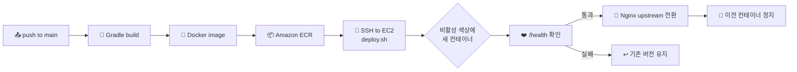

- **블루-그린 무중단 배포**: `spring-boot-blue` / `spring-boot-green` 중 쉬고 있는 쪽에 새 버전을 띄우고, 헬스체크를 통과해야만 트래픽을 넘깁니다.
- Nginx는 동적 resolver를 써서 컨테이너가 새로 떠서 내부 IP가 바뀌어도 옛 주소를 붙잡지 않습니다.
- DB 스키마는 Flyway가 애플리케이션 시작 시 자동으로 마이그레이션합니다(`ddl-auto: validate`).

---

## 💡 기술적으로 고민한 것들

<details>
<summary><b>🌀 동시 편집에서 일정이 통째로 사라지는 문제</b></summary>

처음에는 브라우저마다 자기 화면 상태를 각자 DB에 저장했습니다. 그러다 여러 명이 동시에 편집하면 늦게 도착한 옛 저장 요청이 최신 일정을 덮어써서 하루치 일정이 통째로 사라지는 사고가 났습니다.

→ **저장 주체를 Node 협업 서버 하나로 모으고**, 백엔드에는 하루치 항목을 한 트랜잭션에서 통째로 바꾸는 내부 API를 두었습니다. 여기에 **일차별 버전 낙관적 락 + 멱등키**를 더해, 재전송이나 순서가 뒤바뀐 요청이 와도 결과가 깨지지 않게 했습니다.
</details>

<details>
<summary><b>🤖 AI가 만든 일정을 믿을 수 있게</b></summary>

LLM에게 그냥 맡기면 같은 장소를 두 번 넣거나, 하루를 비우거나, A안과 B안을 똑같이 만들기도 합니다.

→ 서버가 **후보를 미리 걸러서 주고**(반경을 단계적으로 넓히고, 카테고리를 맞추고, 콜드 스타트 때는 구·군별로 고르게), **응답을 검증한 뒤 부족하면 보충**하고, B안은 AI 순서 대신 **좌표 기반으로 다시 정렬**합니다. 그룹원이 동시에 생성을 눌러도 먼저 온 요청이 투표 세션을 선점하고 나머지는 그 결과를 기다리기 때문에, AI 호출은 한 번만 일어납니다.
</details>

<details>
<summary><b>⏰ 시간 계산의 함정</b></summary>

`LocalTime.plusMinutes`를 누적하면 자정을 넘는 순간 `00:20`처럼 한 바퀴 돌아서 늦은 일정이 새벽으로 저장됐습니다.

→ 자정 차단, 하루 종료 시각 상한, 같은 날 시각 중복 방지 규칙을 `ItineraryTimeUtils`로 모아 생성·확정·시작 시각 변경이 모두 같은 규칙을 쓰게 했습니다.
</details>

<details>
<summary><b>🚕 "택시 탈까, 버스 탈까?"를 인원수로 판단하기</b></summary>

4명이면 택시가 버스보다 싸고 빠를 수 있습니다. 요금은 총액 그대로 보여주되, **정렬은 1인당 비용과 아끼는 시간**으로 정합니다. 심야 할증과 시간대별 혼잡도까지 넣어 실제 이동 시각 기준으로 계산합니다.
</details>

<details>
<summary><b>📍 GPS 인증 반경을 장소마다 다르게</b></summary>

박물관 입구 100m는 충분하지만, 넓은 공원이나 섬 산책로는 중심 좌표에서 수백 m 떨어진 곳에 있어도 "그 장소에 와 있는" 상태입니다. 그래서 카테고리별로 100m / 200m / 500m 반경을 다르게 둡니다. 인증 여부는 **일정 항목 단위**로 저장해서 여행마다 새로 도장을 찍는 재미를 살렸습니다.
</details>

<details>
<summary><b>🔒 개인정보는 확실하게 지우기</b></summary>

회원 탈퇴 시 즉시 익명화하고, 30일 유예가 지나면 GPS 좌표가 담긴 방문 기록, 인증 사진, 여행 로그까지 배치로 완전히 삭제합니다. 카카오 연결도 함께 끊습니다.
</details>

---

## 🔗 관련 저장소

| 저장소 | 역할 |
|---|---|
| **Bujirun-backend** (현재) | Spring Boot REST API |
| Bujirun-frontend | Next.js 웹 앱(Vercel 배포) |
| Bujirun-node | Node.js + Yjs 실시간 공동 편집 서버 |

<div align="center">

<br/>

**🌅 부지런히 다니고, 부지런히 모으고, 부지런히 남기자.**

<sub>Made with 🌊 in Busan</sub>

</div>
